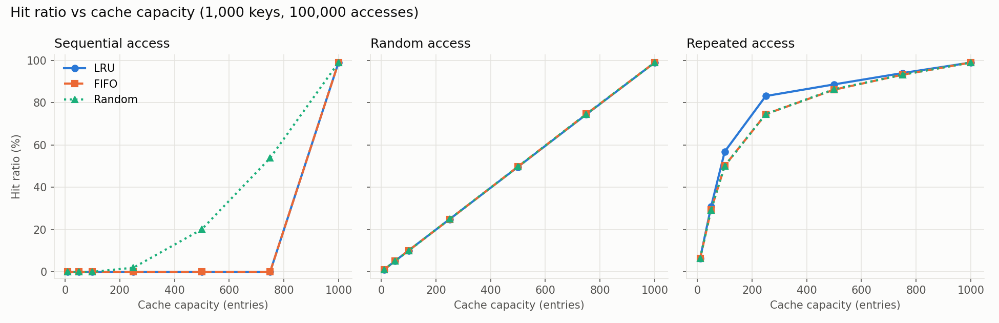
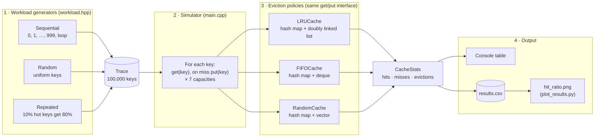
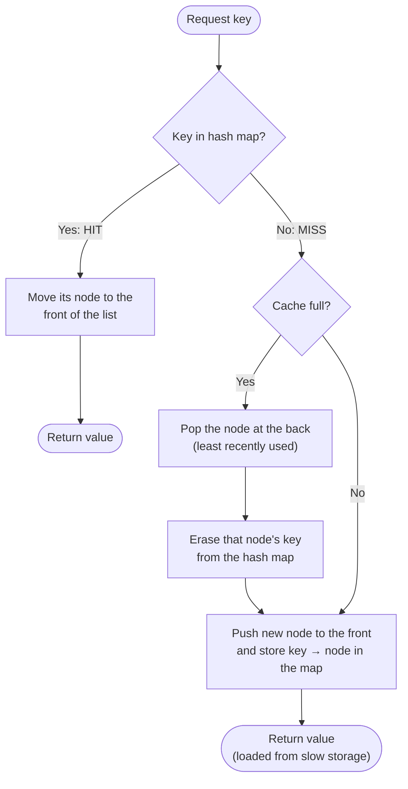

# LRU Cache Simulator

An LRU (Least Recently Used) cache in C++17 with **O(1) `get` and `put`**, plus a simulator that
replays **sequential, random and repeated-access** workloads at different cache capacities and
compares hit/miss ratios against **FIFO** and **Random** eviction.



## Architecture



Every policy replays the **same trace**, so differences in hit ratio come only from the eviction policy.

## How it works

The cache combines two data structures:

```
   unordered_map (key → Node*)             doubly linked list
  ┌─────┬───────┐
  │  3  │   ●───┼──────►  head ⇄ [3] ⇄ [1] ⇄ tail
  │  1  │   ●───┼─────────────────────┘
  └─────┴───────┘               MRU          LRU
```

- **Hash map** (`std::unordered_map<K, Node*>`) finds a key's node in O(1) average time.
- **Doubly linked list** (hand-written, with sentinel head/tail nodes) keeps entries in recency
  order. Any node can be unlinked and moved to the front in O(1), and the least recently used
  entry is always at the back.

| Operation | What happens | Cost |
|---|---|---|
| `get(key)` hit | map lookup → move node to front | O(1) |
| `get(key)` miss | map lookup fails → `std::nullopt` | O(1) |
| `put(key, value)` new key, cache full | pop back node → erase its key from map → push new node to front | O(1) |
| `put(key, value)` existing key | update value → move node to front | O(1) |

Each node stores its key so that, on eviction, the matching map entry can be erased.

### Request flow



## Project structure

```
include/
  doubly_linked_list.hpp   recency list with sentinel nodes
  lru_cache.hpp            LRUCache<K, V>: hash map + linked list
  fifo_cache.hpp           FIFO baseline (evicts oldest inserted)
  random_cache.hpp         Random-eviction baseline (O(1) swap-remove)
  cache_stats.hpp          hit / miss / eviction counters
  workload.hpp             sequential, random and repeated-access trace generators
src/main.cpp               simulator: workloads × capacities × policies → table + CSV
tests/                     unit tests (no external framework)
bench/benchmark.cpp        timing benchmark for the O(1) claim
scripts/plot_results.py    plots results/results.csv → docs/hit_ratio.png
```

## Build and run

Requires CMake ≥ 3.14 and a C++17 compiler (GCC 7+, Clang 5+, MSVC 2017+).

```bash
cmake -S . -B build
cmake --build build

./build/simulator                       # run all workloads, write results/results.csv
./build/simulator --keys 5000 --ops 500000 --seed 7
ctest --test-dir build --output-on-failure
./build/benchmark

pip install matplotlib
python scripts/plot_results.py          # regenerate docs/hit_ratio.png
```

## Workloads

All traces use 1,000 distinct keys and 100,000 accesses with a fixed seed, so results are reproducible.
Every policy replays the exact same trace.

| Workload | Pattern | Models |
|---|---|---|
| Sequential | 0, 1, …, 999, 0, 1, … (looping scan) | iterating over a large array or file repeatedly |
| Random | uniform random key each access | no locality at all |
| Repeated | 10% of keys ("hot set") get 80% of accesses | real programs: popular pages, hot variables |

## Results

Hit ratio (%) at selected capacities:

| Workload | Capacity | LRU | FIFO | Random |
|---|---:|---:|---:|---:|
| Sequential | 250 | 0.00 | 0.00 | 1.97 |
| Sequential | 500 | 0.00 | 0.00 | 20.11 |
| Sequential | 750 | 0.00 | 0.00 | 53.86 |
| Sequential | 1000 | 99.00 | 99.00 | 99.00 |
| Random | 250 | 24.90 | 24.87 | 24.97 |
| Random | 500 | 49.65 | 49.74 | 49.75 |
| Repeated | 100 | **56.88** | 50.19 | 50.11 |
| Repeated | 250 | **83.15** | 74.59 | 74.61 |
| Repeated | 500 | **88.66** | 86.15 | 86.36 |

### Findings

- **Repeated access: LRU wins.** With a hot set, LRU keeps frequently used keys at the front and
  beats FIFO/Random by up to ~8.5 percentage points (capacity 250: 83.2% vs 74.6%). This
  temporal locality is exactly what LRU is designed to exploit.
- **Sequential scan: LRU's worst case.** When the loop is larger than the cache, LRU always evicts
  the key that is needed next, so it gets **0% hits** at every capacity below 1,000 (FIFO behaves
  the same here, so its line sits on top of LRU's in the plot). Random eviction keeps some keys by
  chance and reaches 54% at capacity 750. This is the classic LRU thrashing pattern.
- **Random access: policy doesn't matter.** With no locality, all policies converge to
  hit ratio ≈ capacity / key space (25% at 250, 50% at 500).
- **Capacity matters most once it covers the working set.** In the repeated workload, going from
  50 to 250 entries lifts LRU from 31% to 83%. Past that, gains flatten.
- At capacity = key space (1,000), every policy hits 99%. The remaining 1% are compulsory
  (first-access) misses.

## O(1) benchmark

Average time per access (get, plus put on a miss), 2 million accesses, ~50% hit rate:

| Capacity | ns per access |
|---:|---:|
| 1,000 | 56.8 |
| 10,000 | 69.2 |
| 100,000 | 135.1 |
| 1,000,000 | 241.8 |

Capacity grows **1,000×** while time per operation grows only ~5×. An O(n) cache would slow down
roughly 1,000×. The modest increase comes from the memory hierarchy: at large capacities the hash
table and nodes no longer fit in CPU cache, so each access pays for RAM latency. The algorithm
itself does the same constant work.

## Testing

- **12 LRU tests**: eviction order, recency refresh on `get`, updates via `put`, capacity 1,
  capacity 0 (throws), `contains` not affecting order, statistics, string keys.
- **Randomised reference-model test**: 20,000 random operations checked step by step against a
  simple O(n) vector-based LRU.
- **5 policy tests** for FIFO and Random eviction.